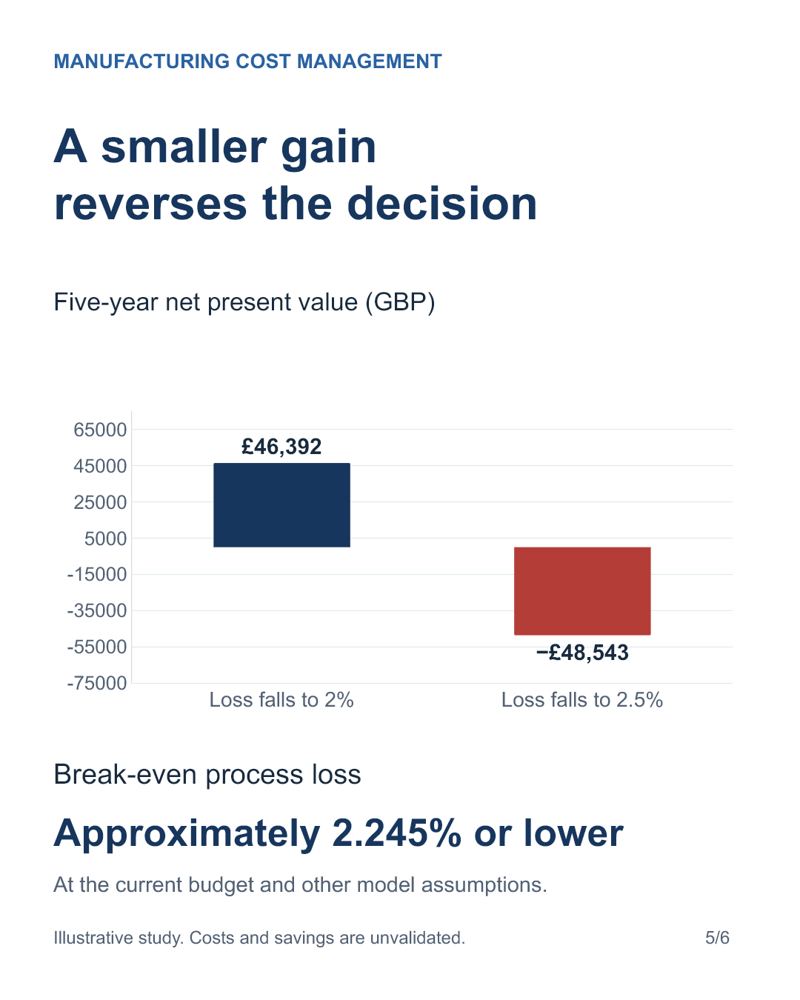

# Cost management portfolio

Independent cost management case studies by **Sankha Bhattacharjee**.

This portfolio connects quantity and rate cost estimates to practical investment decisions. Each case separates published context, illustrative assumptions and evidence that would be required before implementation.

## Project 01: manufacturing

### Should a detergent line invest in material-loss controls?

A hypothetical UK liquid-detergent line informed by Unilever's public reporting. The study builds production costs from material quantities, packaging, paid labour hours, electricity, waste disposal and freight, then appraises a proposed process improvement.

**The main finding:** reducing process loss from 3% to 2% gives a positive five-year investment value under the model assumptions. Reaching only 2.5% still saves money but makes the equipment investment unattractive.

[Explore the case study](projects/manufacturing-detergent/README.md) · [Open the Excel model](projects/manufacturing-detergent/model/Detergent-Line-Investment-Case.xlsx) · [Read the investment brief](projects/manufacturing-detergent/reports/Investment-Brief.pdf)

## Skills demonstrated

- Quantity and rate cost estimation, with a reconciled material mass balance.
- Separation of fixed costs, variable costs and avoidable expenditure.
- Capital budgeting, implementation timing and lost-contribution analysis.
- Discounted cash-flow appraisal, break-even calculations and sensitivity testing.
- Management recommendations supported by an explicit validation plan.

## Evidence boundaries

These are independent educational projects. The manufacturing model is hypothetical and does not disclose or estimate Unilever's actual factory costs. No production trial has been conducted and no savings have been achieved. Engineering quantities, purchase rates and equipment budgets require validation.

I used AI assistance to help construct and check the workbook and prepare the presentation, and worked through the assumptions and sensitivity tests to understand the recommendation.
