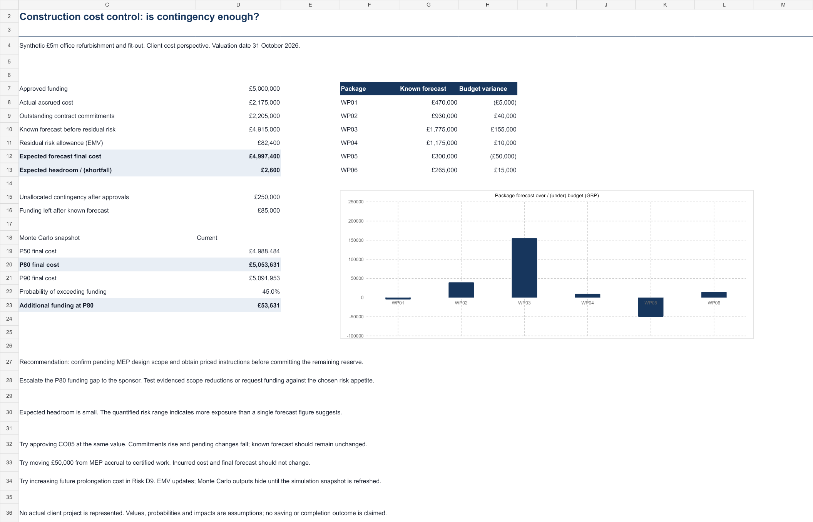
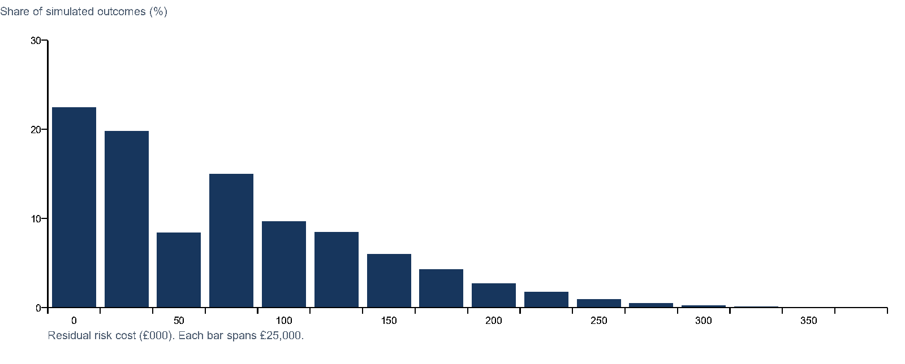

# Construction cost control: is contingency sufficient?

**Project 02 in Sankha Bhattacharjee's cost management portfolio.**

A client-side forecast final cost review for a hypothetical **£5 million office refurbishment and fit-out**, using synthetic package awards, certified valuations, accruals, change orders and risk inputs.

**Reporting cutoff: 31 October 2026. Prepared: 5 November 2026.** All amounts are GBP, excluding VAT, land, professional fees and financing.

## The management finding

The expected forecast is **£4,997,400**, leaving only **£2,600** below the approved funding cap. The same assumptions produce a **P80 cost of £5,053,631**, a **£53,631 funding gap** at that selected confidence level.

The modelled probability of exceeding the £5 million cap is approximately **45.0%**. These probabilities describe the synthetic simulation, not a measured likelihood for a real project.

**Recommendation:** validate the pending MEP design scope and price instructions before committing further reserve. The sponsor should choose the funding confidence it requires, then address exposure through evidenced scope reduction, mitigation or funding. A P80 funding policy is an illustrative decision choice, not a universal requirement.

## Open the deliverables

- [Two-page management report](reports/Construction-Cost-Control-Report.pdf).
- [Editable Excel cost-control model](model/Construction-Cost-Control.xlsx), starting on Dashboard.
- [Step-by-step walkthrough](WALKTHROUGH.md).
- [Authoritative synthetic input dataset](data/project-inputs.json).
- [Published forecast and simulation output](data/published-results.json).
- [Reproducible Python model](src/model.py) and [17 verification tests](tests/test_model.py).



## Forecast bridge

| Component | Amount |
| --- | ---: |
| Certified gross work valuations | £1,930,000 |
| Uncertified accruals | £245,000 |
| Outstanding current commitments | £2,205,000 |
| Unlet quantity × rate scope | £165,000 |
| Known base-scope gaps | £55,000 |
| Pending known changes | £315,000 |
| **Known forecast before residual risk** | **£4,915,000** |
| Residual risk allowance, analytical EMV | £82,400 |
| **Expected forecast final cost** | **£4,997,400** |

The total current contract value is £4,380,000. Actual accrued cost of £2,175,000 plus £2,205,000 of outstanding commitments reconciles to it. Adding the entire contract value to actual cost would double count completed work.

Approved changes transfer £250,000 of the original £500,000 contingency into package budgets. The current allocated budget is £4,750,000. The known forecast is £165,000 above that allocation, so the funding cap can absorb only £85,000 of residual risk.

## What makes this case more advanced

### Cost recognition and commitments

Certified valuations are gross work values before retention, not cash payments. Accruals represent completed work not included in those valuations. Remaining contract commitment is current contract value less those incurred costs. The model is not a contractor profit statement or a payment cash-flow schedule.

### Change governance and cutoffs

Approved changes enter commitments and package budgets once. Pending changes enter at their full best-estimate values. Rejected changes and unapproved opportunities are excluded. The later CO10 instruction is excluded at the October cutoff and enters when the reporting date advances beyond its event date.

Approving CO05 at the same agreed value increases commitments and reduces pending forecast by equal amounts. It does not increase the forecast final cost again. The original awards explicitly exclude approved variations.

### Scope overlap prevention

Risk R04 links to CO07. While that change is included in the forecast, the overlapping risk is excluded from residual risk allowances. Unlet work and base-scope gaps also have explicit boundaries so they do not repeat contract or change scope.

### Quantified residual risk

Three active event risks use independent Bernoulli occurrence and triangular impact distributions. Future delay is one mutually exclusive categorical distribution: no delay at 55%, four weeks at 35%, or eight weeks at 10%, valued at £12,000 per week. Those assumptions produce £56,000 of event-risk EMV and £26,400 of delay-risk EMV.

A **50,000-draw simulation with seed 53526** produces the following snapshot:

| Measure | Simulated cost |
| --- | ---: |
| P50 | £4,988,484 |
| P80 | £5,053,631 |
| P90 | £5,091,953 |
| P95 | £5,123,457 |

The analytical expected forecast is not labelled P50. P80 means 80% of the simulated outcomes are at or below that amount under the selected assumptions.



## Reproduce and challenge the analysis

Python 3.10 or later is sufficient. The model and tests use only the standard library.

From the repository root:

```sh
python projects/construction-cost-control/src/model.py
python -m unittest discover -s projects/construction-cost-control/tests -v
```

For a revised simulation, copy and edit the JSON input, then run:

```sh
python projects/construction-cost-control/src/model.py --inputs path/to/revised-inputs.json --output path/to/revised-results.json
```

The script validates package keys, duplicates, change status, risk distributions, probabilities and overdrawn commitments. Tests cover budget reconciliation, change reclassification, accrual certification, future cutoffs, opportunity exclusion, duplicate scope suppression, delayed-cost arithmetic and seeded reproducibility.

## Excel refresh behaviour

The deterministic cost forecast, change register, risk EMV and native two-input sensitivity table recalculate from editable inputs. The Monte Carlo quantiles are a **fixed published snapshot**.

The Risk sheet compares live inputs with the saved simulation drivers. When a relevant input changes, it marks the snapshot stale and Dashboard hides the quantiles. Restoring the exact original drivers makes that snapshot applicable again.

Excel changes do not update the JSON dataset. To refresh the simulation, update the JSON and run Python. Rebuilding the Excel snapshot or deliberately refreshing its result cells and saved driver values is a separate reconciliation step. The revised JSON outputs can be used independently. Do not relabel a stale spreadsheet snapshot as current without that work.

## Evidence, limitations and sources

All amounts, contract records, quantities, probabilities and impacts are **synthetic assumptions**, with no actual client or contractor data. No construction savings or delivery outcome has been achieved through this case.

Methodological references:

- [Infrastructure and Projects Authority, Cost Estimating Guidance (2021)](https://www.gov.uk/government/publications/cost-estimating-guidance/cost-estimating-guidance), for ranges, risk allowances, assumptions and cost-estimate assurance.
- [RICS, Cost reporting, first edition (2015)](https://www.rics.org/content/dam/ricsglobal/documents/standards/cost_reporting_1st_edition_rics.pdf), a historical methodological reference for incurred costs, forecasts and risk allowances.

The case does not claim professional certification or full compliance with either source. It is narrower than a full project cost plan, contract assessment or commercial final account.

The simulation assumes independent events and fixed known costs. Correlated risks, unlisted risks, uncertainty in pending change valuations and other model omissions can materially change the cost range. The seeded output is reproducible; that does not make its assumptions empirically validated.
